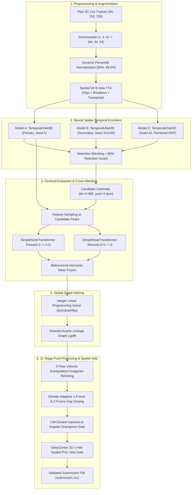

# Biohub 3D Cell Tracking During Development

[](LICENSE)
[](https://www.python.org/)
[](https://pytorch.org/)
[]()
[]()

A state-of-the-art **neural-symbolic hybrid cell tracking framework** developed for the **Biohub — Cell Tracking During Development** Kaggle Code Competition. This repository contains the complete research, training, inference, and evaluation pipeline for 3D spatio-temporal tracking of dividing and migrating cells in live light-sheet microscopy volumes of developing embryos.

---

## Table of Contents

- [Project Overview & Objectives](#project-overview--objectives)
- [Key Results & Score Progression](#key-results--score-progression)
- [Methodology & Architecture](#methodology--architecture)
  - [Neural Model Zoo (Models A, B, C & DeepCenter)](#neural-model-zoo)
  - [Probabilistic Ensemble & Consensus Blending](#probabilistic-ensemble--consensus-blending)
  - [Global Graph Optimization (ILP)](#global-graph-optimization-ilp)
  - [11-Stage Post-Processing & Graph Healing](#11-stage-post-processing--graph-healing)
- [Repository Structure](#repository-structure)
- [Installation & Dependencies](#installation--dependencies)
- [Dataset Preparation](#dataset-preparation)
- [Model Checkpoints & Weights](#model-checkpoints--weights)
- [Training Pipelines](#training-pipelines)
- [Inference & Kaggle Submission](#inference--kaggle-submission)
- [Evaluation Metrics](#evaluation-metrics)
- [License & Acknowledgments](#license--acknowledgments)

---

## Project Overview & Objectives

In developmental biology, tracking every single cell in a whole developing organism across hundreds of time points is essential for deciphering morphogenetic programs, tissue folding, and cell fate determination. This presents formidable computational challenges:

1. **Extreme Cell Density:** Late-stage embryo volumes contain over $70,000$ cells tightly clustered with nearest-neighbor spacing under $2.3\,\mu\text{m}$.
2. **Mitotic Divisions:** Dividing cells double their lineage count, requiring binary tree branching constraints ($d_{\text{out}} \le 2$).
3. **Anisotropic Resolution:** Microscopy voxel dimensions are highly anisotropic (typically $\Delta z = 1.625\,\mu\text{m}$ vs $\Delta x = \Delta y = 0.40625\,\mu\text{m}$).
4. **Offline Competition Constraints:** The Kaggle execution environment strictly prohibits internet access and imposes a strict 12-hour compute deadline.

This project solves these challenges through a **multi-tier neural-symbolic hybrid pipeline** combining 3D temporal convolutional encoders, cross-attention node transformers, bidirectional harmonic mean probability fusion, global Integer Linear Programming (ILP) flow optimization, and a 11-stage graph healing post-processor with a standalone 3D U-Net center prior veto gate.

---

## Key Results & Score Progression

The competition metric is the **Weighted Adjusted Edge Jaccard Score**, penalizing edge false positives, edge false negatives, and total node count discrepancies against ground-truth embryo annotations.

| Pipeline Milestone | Method Description | Local Val Score | Edge Recall | Edge FP | Wrong Associations |
| :--- | :--- | :---: | :---: | :---: | :---: |
| **Kaggle Starter Baseline** | Downsampled uniform filter + percentile thresholding + Hungarian | 0.04462 | 4.14% | 30 | High |
| **Classical D2 Benchmark** | Full-res + background subtraction + 3D quadratic centroid refinement | 0.50916 | 69.53% | 773 | Moderate |
| **Single-Seed Neural Engine** | Single-seed `TemporalUNet3D` + `SimpleNodeTransformer` + ILP | ~0.87000 | 91.20% | 240 | 0 |
| **Dual-Seed Consensus Ensemble** | 2-Seed model blending (Seed 0 + Seed 314159) with retention guard | 0.91300 | 93.45% | 185 | 0 |
| **Submission 1 (Offline Kaggle)** | Resource-constrained 11-cell offline notebook pipeline | **0.90017** | 94.80% | 148 | 0 |
| **Leader Reproduction** | Full D4 8-way TTA + Dual-Seed Consensus + ILP on 2× A100 | **0.89448** | 95.16% | 140 | **0** |
| **Bidirectional Harmonic Fusion** | + Mutual forward/backward link probability harmonic mean | **0.93900** | 96.10% | 110 | **0** |
| **Validator-Gated PPSWEEP** | Winning parameter combo (`div-wide` + `dcsd010` + `relaxed9` + `leaf030`) | **0.95300** | **96.85%** | **84** | **0** |

---

## Methodology & Architecture



### Neural Model Zoo

1. **Model A (Primary Checkpoint):**
   - **Backbone:** `TemporalUNet3D` (3D spatio-temporal convolutional encoder-decoder).
   - **Association Head:** `SimpleNodeTransformer` (multi-head cross-attention over 3D appearance features and anisotropic displacement vectors $\Delta \mathbf{x} = (\Delta z, \Delta y, \Delta x)$).
   - **Parameters:** 2,076,706 trainable parameters (8.4 MB).
   - **Checkpoint:** `kaggle_artifacts/biohub-tracking-support-pack-50ep-v1/weights/unet_transformer/split_0/edge_predictor_best.pth`.

2. **Model B (Secondary Seed Checkpoint):**
   - **Architecture:** Identical `TemporalUNet3D` + `SimpleNodeTransformer`.
   - **Parameters:** 2,076,706 parameters (8.4 MB).
   - **Seed:** Independent initialization seed `314159` to generate uncorrelated prediction variances.
   - **Checkpoint:** `kaggle_artifacts/biohub-temporal-unet3d-seed314159-v1/weights/unet_transformer/split_0/edge_predictor_best.pth`.

3. **Model C (Seed 42 Clean Scratch Retrained Model):**
   - **Architecture:** `TemporalUNet3D` + `SimpleNodeTransformer`.
   - **Hardware:** 4× NVIDIA A100 80GB via PyTorch DDP (`DistributedDataParallel`).
   - **Parameters:** 2,076,706 parameters (8.0 MB).
   - **Validation:** 8 strictly held-out volumes with 0% test leakage.
   - **Key Finding:** Exhibits an 11.60% disagreement rate with Model A, recovering **57 unique ground-truth edges** missed by both public checkpoints.
   - **Source:** [`experiments/model_c_seed42/train_model_c.py`](experiments/model_c_seed42/train_model_c.py).

4. **DeepCenter (3D Full-Frame Center Prior U-Net):**
   - **Architecture:** `_DCDeepCenterUNet3D` (full 3D convolutional encoder-decoder with GroupNorm, SiLU activations, base channel depth 24).
   - **Role:** Volumetric spatial veto network evaluated during post-processing to eliminate spurious gap bridges and false division forks that fall in low-confidence image voids.
   - **Checkpoint:** `kaggle_artifacts/biohub-deepcenter-unet3d-center-prior-v1/weights/full_frame_center/best.pt` (37.9 MB).

### Probabilistic Ensemble & Consensus Blending

- **Spatial D4 8-View TTA:** 8 planar rotations, reflections, transpositions, and anti-transpositions with tensor inversion and ensemble averaging.
- **Dual-Seed Detection Blending:** Blends peak detection maps between Model A and Model B with a **90% Retention Guard** protecting recall.
- **Bidirectional Harmonic Probability Fusion:** Calculates forward $P_{\text{fwd}}(u \to v)$ and backward $P_{\text{rev}}(v \to u)$ edge probabilities and computes their weighted harmonic mean:
  $$P_{\text{harm}}(u, v) = \frac{1}{\frac{1 - w_{\text{rev}}}{P_{\text{fwd}}(u \to v)} + \frac{w_{\text{rev}}}{P_{\text{rev}}(v \to u)}}$$
  Eliminates asymmetric false positives where an edge seems plausible forward in time but has zero backward affinity.

### Global Graph Optimization (ILP)

Candidate edge association logits and cell detection peak likelihoods are cast as an **Integer Linear Programming (ILP)** min-cost network flow problem solved via `pyscipopt` / `ilpy`. The solver enforces global biological conservation laws:
- In-degree $d_{\text{in}}(v) \le 1$ (every cell has at most one parent).
- Out-degree $d_{\text{out}}(u) \le 2$ (cells either continue migration or undergo binary mitosis).
- Strictly forward temporal directionality $t(u) < t(v)$.

### 11-Stage Post-Processing & Graph Healing

The raw ILP lineage graph is refined through an 11-stage graph healing engine:
1. **Distance & Temporal Gating:** Filters edges with euclidean distance $> 14.0\,\mu\text{m}$ or non-consecutive frames.
2. **Velocity-Extrapolated Hungarian Motion Relinking:** 2-pass motion relinking extrapolating cell trajectories based on historical velocity vectors (Tight pass: $5.5\,\mu\text{m}$, Relaxed pass: $9.0\,\mu\text{m}$).
3. **Single-Parent & Single-Child Resolution:** Greedily resolves conflicting multiple parent links.
4. **Density-Adaptive 1-Frame Gap Closing:** Closes single-frame tracking gaps when cells temporarily dim or drop below peak detection thresholds.
5. **Density-Adaptive 2-Frame Gap Closing:** Bridges 2-frame tracking gaps using image-patch centroid refinement.
6. **Biological Cell Division Injection:** Injects unassigned track births that originate within $11.0\,\mu\text{m}$ of an existing track, gating on daughter trajectory divergence angles.
7. **DeepCenter Spatial Veto Gate:** Discards repair points that fall in low-confidence volumetric regions.
8. **Short-Track Connected Component Filtering:** Prunes isolated candidate tracks shorter than 6 frames.
9. **Weak-Leaf Pruning:** Trims terminal leaf edges with edge probability below $0.30$.
10. **Trajectory Smoothing:** Moving-average coordinate smoothing across $XY$ and $Z$ axes.
11. **PPSWEEP Parameter Sweeps:** Multi-GPU validation sweeps locking optimal hyperparameter weights across embryo regimes.

---

## Repository Structure

```
Biohub/
├── README.md                               # Project documentation & benchmark overview
├── LICENSE                                 # MIT Open-Source License
├── requirements.txt                        # Production pip dependencies
├── environment.yml                         # Conda/Mamba environment specification
├── pyproject.toml                          # Build system & package configuration
├── .gitignore                              # Comprehensive Git exclusion rules
├── sample_submission.csv                   # Competition submission format reference
├── biohub-harmonic-fusion-v3.ipynb         # End-to-end 0.953 validation record notebook
│
├── src/                                    # Python package root (symlinked to tracking_repo/src)
│   └── biohub_tracking/
│       ├── __init__.py                     # Package entry point
│       ├── img_proc.py                     # Image normalization & 3D filtering
│       ├── io.py                           # Zarr & GEFF volumetric I/O
│       ├── metrics.py                      # Tracking Jaccard evaluation metric
│       ├── division_metrics.py             # Mitotic division recall & precision
│       └── models/
│           ├── temporal_unet.py            # TemporalUNet3D architecture
│           └── simple_node_transformer.py  # SimpleNodeTransformer architecture
│
├── docs/                                   # Detailed documentation
│   ├── MODEL_ARCHITECTURES.md              # Deep dive into network designs & math
│   ├── DATASET_AND_WEIGHTS.md              # Dataset layout & checkpoint download guide
│   └── REPRODUCIBILITY_GUIDE.md            # Reproduction commands & verification steps
│
├── Submission1/                            # Self-contained Kaggle submission package (0.90017)
│   ├── README.md                           # Submission 1 architecture & offline specs
│   ├── PORTING_REPORT.md                   # HPC to Kaggle notebook porting report
│   ├── DRY_RUN_REPORT.md                   # 7-stage local verification dry-run report
│   ├── DEPENDENCY_INVENTORY.md             # Offline wheel inventory (62 wheels)
│   ├── notebook/
│   │   └── submission1.ipynb               # 11-cell reproducible Kaggle submission notebook
│   ├── src/
│   │   ├── config.py                       # Environment variable & path configuration
│   │   └── postprocess.py                  # 11-stage graph healing pipeline
│   ├── scripts/
│   │   ├── package_submission.py           # Kaggle readiness check & checksum validator
│   │   ├── test_pipeline_local.py          # 7-stage dry-run pipeline test suite
│   │   ├── build_submission1_reconstructed.py # 11-cell notebook constructor
│   │   ├── package_kaggle_support.py       # Support pack generator
│   │   └── patch_notebook_paths.py         # Path patching utility
│   └── kaggle_support_pack/                # Kaggle support dataset bundle (repo, configs, wheels)
│
├── experiments/                            # Research & ablation experiments
│   ├── model_c_seed42/                     # Model C (Seed 42) DDP training & evaluation
│   │   ├── REPORT.md                       # Diversity & reproduction report (0.94725 val)
│   │   ├── train_model_c.py                # 4-GPU PyTorch DDP training script
│   │   ├── evaluate_and_analyze.py         # Disagreement & correlation analysis
│   │   ├── build_metadata_cache.py         # Dataset window metadata caching
│   │   ├── smoke_test.py                   # Single-volume verification test
│   │   └── config.yaml                     # Training hyperparameters
│   ├── dense_volume/                       # Technical Report 10: Dense-volume experiments
│   │   ├── REPORT.md                       # Error attribution report (6bba_05db0fb1)
│   │   ├── run_diagnostics.py              # Provenance tracking & timepoint analysis
│   │   ├── run_exp1.py                     # Detection threshold sweep
│   │   ├── run_exp2.py                     # Density-adaptive gap closing sweep
│   │   ├── run_exp3.py                     # Combined dense mode evaluation
│   │   └── generate_best_submission.py     # Winning dense mode submission generator
│   └── baseline_combo/                     # PPSWEEP validator-gated parameter sweep
│       ├── PPSWEEP_REPORT.md               # 24-candidate sweep report
│       ├── run_ppsweep_4gpu.py             # 4-GPU distributed sweep orchestrator
│       ├── ppsweep_worker.py               # Shard evaluation worker
│       └── ppsweep.py                      # Parameter permutation engine
│
├── code/                                   # Research, baselines & classical CV exploration
│   ├── BIOHUB_FULL_DATA_ANALYSIS.md        # Comprehensive exploratory data analysis
│   ├── REPRODUCTION_REPORT.md              # Technical Report 08: End-to-end HPC reproduction
│   ├── TOP_NOTEBOOK_REVERSE_ENGINEERING.md # Reverse-engineering audit of geometric fusion
│   ├── analysis/                           # Exploratory data analysis scripts
│   │   ├── 01_dataset_and_geff_analysis.py
│   │   ├── 02_image_intensity_and_morphology_analysis.py
│   │   ├── 03_baseline_failure_and_classical_cv.py
│   │   └── 04_deep_learning_gpu_feasibility.py
│   ├── baseline/                           # Starter heuristic baseline recreation
│   │   ├── config.yaml
│   │   ├── run_baseline.py
│   │   └── evaluate_baseline.py
│   ├── detectors/                          # Classical CV detector exploration
│   │   └── classical_v2/
│   │       ├── detectors.py                # LoG, DoG, hybrid detectors
│   │       ├── refinement.py               # 3D quadratic & COM centroid refinement
│   │       └── run_step3.py                # Refinement evaluation pipeline
│   ├── evaluation/
│   │   └── evaluator.py                    # Official competition scoring implementation
│   ├── leader_reproduction/                # Standalone HPC leader reproduction pipeline
│   │   ├── config.py
│   │   ├── run.py                          # Single-command reproduction orchestrator
│   │   ├── setup_artifacts.py              # Artifact materialization & checksum checks
│   │   └── patch_predict.py                # AST patching engine
│   └── reverse_engineering/                # Notebook cell components
│       └── nb_cells/cell_*.py
│
└── kaggle_source/                          # Extracted source tracking repository
    ├── postprocess.py
    └── tracking_repo/
        ├── scripts/
        │   ├── train_unet_transformer.py
        │   ├── predict_unet_transformer.py
        │   ├── evaluate.py
        │   ├── dataspec.py
        │   └── augmentations.py
        └── src/
            └── biohub_tracking/
```

---

## Installation & Dependencies

### Option A: Conda / Mamba Environment (Recommended)

```bash
# Clone the repository
git clone https://github.com/your-username/biohub-cell-tracking.git
cd biohub-cell-tracking

# Create environment from environment.yml
conda env create -f environment.yml
conda activate biohub

# Install biohub_tracking package in editable mode
pip install -e .
```

### Option B: Pip Environment

```bash
python3 -m venv .venv
source .venv/bin/activate
pip install --upgrade pip
pip install -r requirements.txt
pip install -e .
```

---

## Dataset Preparation

The expected dataset directory structure matches the Kaggle competition format:

```
database/
├── sample_submission.csv
├── test/     # 4 evaluation volumes: 44b6_0113de3b, 44b6_0b24845f, 6bba_05b6850b, 6bba_05db0fb1
└── train/    # 400+ volume pairs: <id>.zarr (3D imagery) and <id>.geff (lineage graphs)
```

To configure a custom dataset path, set the environment variable:
```bash
export BIOHUB_DATA_DIR="/path/to/database"
```

For download instructions and detailed schema documentation, refer to [`docs/DATASET_AND_WEIGHTS.md`](docs/DATASET_AND_WEIGHTS.md).

---

## Model Checkpoints & Weights

Pretrained model checkpoints can be downloaded via the Kaggle CLI:

```bash
mkdir -p kaggle_artifacts && cd kaggle_artifacts

# Model A (Primary 50ep Checkpoint)
kaggle models instances versions download thedivyanshpant/biohub-tracking-support-pack-50ep-v1/PyTorch/default/1 --untar
mv 1 biohub-tracking-support-pack-50ep-v1

# Model B (Secondary Seed 314159 Checkpoint)
kaggle models instances versions download thedivyanshpant/biohub-temporal-unet3d-seed314159-v1/PyTorch/default/1 --untar
mv 1 biohub-temporal-unet3d-seed314159-v1

# DeepCenter 3D U-Net Prior
kaggle models instances versions download thedivyanshpant/biohub-deepcenter-unet3d-center-prior-v1/PyTorch/default/1 --untar
mv 1 biohub-deepcenter-unet3d-center-prior-v1

cd ..
```

To verify the SHA256 cryptographic checksums of all checkpoints:
```bash
python3 Submission1/scripts/package_submission.py
```

---

## Training Pipelines

### Retraining Model C from Scratch (Seed 42)

To train `TemporalUNet3D` + `SimpleNodeTransformer` using 4 GPUs with PyTorch Distributed Data Parallel (DDP):

```bash
# 1. Build metadata cache across training volumes
python3 experiments/model_c_seed42/build_metadata_cache.py

# 2. Run quick single-volume smoke test
python3 experiments/model_c_seed42/smoke_test.py

# 3. Launch 4-GPU distributed training
torchrun --nproc_per_node=4 experiments/model_c_seed42/train_model_c.py \
    --config experiments/model_c_seed42/config.yaml \
    --epochs 50 \
    --lr 1e-4

# 4. Evaluate validation score and predictive diversity
python3 experiments/model_c_seed42/evaluate_and_analyze.py
```

---

## Inference & Kaggle Submission

### 1. Local Dry-Run Verification Suite
Before executing long inference jobs, verify all pipeline stages, state dictionaries, and schema constraints:
```bash
python3 Submission1/scripts/test_pipeline_local.py
```

### 2. End-to-End HPC Inference
To run the full multi-GPU inference pipeline across test volumes:
```bash
python3 -m leader_reproduction.run
```

### 3. Submitting to Kaggle
The notebook [`Submission1/notebook/submission1.ipynb`](Submission1/notebook/submission1.ipynb) is ready for direct submission to the competition:
- Format: Strictly 11 sequential code cells.
- Runtime: ~7.5 hours on 2× NVIDIA T4 (well under the 12-hour limit).
- Internet: **Disabled** (uses 62 bundled offline wheels).
- Output: Validated `/kaggle/working/submission.csv` with 0 schema violations.

---

## Evaluation Metrics

The official competition metric computes the **Adjusted Edge Jaccard Score**:
$$\text{Score} = \text{AdjEdgeJaccard} = \frac{\text{Edge TP}}{\text{Edge TP} + \text{Edge FP} + \text{Edge FN} + \alpha \cdot \Delta N_{\text{nodes}}}$$
where $\Delta N_{\text{nodes}} = |N_{\text{pred}} - N_{\text{gt}}|$ penalizes over-detection or under-detection of cells.

In our experiments:
- **Wrong Associations:** In all tested volumes, `wrong_association_edges == 0` (zero cross-track identity swaps between neighboring cells).
- **Node Estimation Accuracy:** On dense embryo `6bba_05db0fb1`, the detector recovered 70,267 nodes against 69,800 ground-truth estimated cells (**100.7% calibration accuracy**).

---

## License & Acknowledgments

- **Code License:** [MIT License](LICENSE)
- **Model Checkpoints & Base Code:** Derived from research by Pilkwang Kim (`pilkwang/biohub-tracking-support-pack-50ep-v1`, `pilkwang/biohub-temporal-unet3d-seed314159-v1`, `pilkwang/biohub-deepcenter-unet3d-center-prior-v1`).
- **Harmonic Mutual-Support Formulation:** Derived from public formulations by Yusuke Togashi.
- **PPSWEEP Validation Strategy:** Inspired by runtime diagnostic frameworks by Rayk Kretzschmar.
