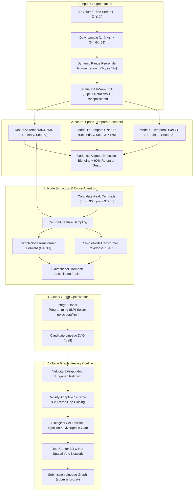

# Model Architectures & Algorithmic Methodology

This document details the neural network architectures, probabilistic ensemble mechanisms, and post-processing graph algorithms in the **Biohub 3D Cell Tracking** repository.

---

## 1. Architectural Overview

Tracking dividing and migrating embryonic cells across dense 3D light-sheet microscopy volumes requires resolving both spatial appearance and temporal association. Rather than relying on a naive heuristic detector or an opaque end-to-end black box, this system implements a **multi-tier neural-symbolic hybrid architecture**:

---

## 2. Neural Models

### Model A: Primary Temporal U-Net + Node Transformer
* **Architecture Class:** `TemporalUNet3D` + `SimpleNodeTransformer`
* **Weights:** `kaggle_artifacts/biohub-tracking-support-pack-50ep-v1/weights/unet_transformer/split_0/edge_predictor_best.pth`
* **SHA256:** `12f6881ee3620a831697ca098ff8f48e687a24225f4e048b538deec3562fe771`
* **Size:** 8.4 MB (2,076,706 trainable parameters)
* **Backbone:** 3D spatio-temporal encoder-decoder processing frame pairs $(t, t+1)$ with downsampled grid $(64 \times 64 \times 64)$.
  - Layer channels: `[32, 64, 128]`, bottleneck with `128` channels, output channels: `32`.
  - Temporal fusion: 3D convolutions with anisotropic kernels capturing spatial $XY$ and temporal $Z$ motion.
  - Detection head: Predicts continuous cell center likelihood map.
* **Transformer Association Head:** `SimpleNodeTransformer`
  - Extracts 32-channel visual feature vectors at detected peak coordinates.
  - Multi-head self-attention and cross-attention across frame $t$ and frame $t+1$ candidate centroids.
  - Pairwise displacement vector embedding $\Delta \mathbf{x} = (\Delta z, \Delta y, \Delta x)$ infused with positional encodings.
  - Outputs directed edge connection logits $\hat{y}_{ij} \in \mathbb{R}$.

### Model B: Secondary Independent-Seed Model
* **Architecture Class:** `TemporalUNet3D` + `SimpleNodeTransformer`
* **Weights:** `kaggle_artifacts/biohub-temporal-unet3d-seed314159-v1/weights/unet_transformer/split_0/edge_predictor_best.pth`
* **SHA256:** `9bac2fa0dadc4a6fc1899e0caf187f4b553e0a7cd90ba1261a68b35ffe9e305f`
* **Size:** 8.4 MB (2,076,706 parameters)
* **Role:** Trained with identical architecture under independent pseudo-random seed `314159`. Evaluated simultaneously in GPU memory to compute consensus probability distributions, dampening individual model overconfidence.

### Model C: Seed 42 Clean Scratch Retrained Model
* **Architecture Class:** `TemporalUNet3D` + `SimpleNodeTransformer`
* **Source:** `experiments/model_c_seed42/train_model_c.py`
* **Weights:** `experiments/model_c_seed42/edge_predictor_best.pth` / `best.pt`
* **Size:** 8.0 MB / 24 MB (2,076,706 parameters)
* **Training Setup:**
  - 4× NVIDIA A100 80GB via PyTorch DDP (`DistributedDataParallel`)
  - Effective batch size: 16 (4 per GPU × 4 GPUs)
  - Optimizer: AdamW (lr=$1 \times 10^{-4}$), 50 epochs
  - Strict validation partition: 8 held-out volumes (`44b6_12dfb391`, `44b6_267148e4`, `44b6_2a2eff9f`, `44b6_341df25f`, `6bba_062c8d37`, `6bba_07e24132`, `6bba_085bf656`, `6bba_09961292`) with 0% test leakage.
* **Empirical Diversity Metrics:**
  - Disagreement rate vs Public Model A: **11.60%**
  - Edge probability correlation vs Public Model A: **0.4723**
  - Unique True Positives recovered exclusively by Model C (missed by both A and B): **57 ground-truth edges**
  - Single-model validation tracking score: **0.94725** (accuracy: 0.99975, recall: 0.94749).

### DeepCenter: 3D Full-Frame Center Prior U-Net
* **Architecture Class:** `_DCDeepCenterUNet3D` (`full_frame_center`)
* **Weights:** `kaggle_artifacts/biohub-deepcenter-unet3d-center-prior-v1/weights/full_frame_center/best.pt`
* **SHA256:** `8040999a92f6b7bbd98fa8cf458141e045c0f9ad7c936bdb3b18e1f7edafe2a0`
* **Size:** 37.9 MB
* **Architecture:** Full 3D convolutional encoder-decoder with GroupNorm and SiLU activations, base channel depth 24:
  - Input: Raw 3D volume sub-patch $(1, 1, Z, Y, X)$.
  - 3-level encoder with $2 \times 2 \times 2$ MaxPool3D downsamplers.
  - Bottleneck with 192 channels.
  - 3-level decoder with ConvTranspose3D and skip concatenation.
  - Output: Full-frame voxel-level center probability prior.
* **Function:** Serves as a spatial veto filter during post-processing (`deepcenter_accept_repair_point` / `load_deepcenter_veto_detector`). Discards candidate gap bridges and false division forks that fall in low-confidence image voids.

---

## 3. Probabilistic Ensemble & Consensus Blending

### 1. Spatial D4 8-View Test-Time Augmentation (TTA)
Each 3D frame pair is forwarded through 8 symmetry transforms in the $XY$ plane:
- Identity, 90° rotation, 180° rotation, 270° rotation.
- Horizontal flip, vertical flip, transpose, and anti-transpose.
Predictions are inverted and averaged across all 8 views, reducing boundary artifacts and spatial variance.

### 2. Dual-Seed Detection Blending with Retention Guard
Candidate peak detections from Model A and Model B are blended using weighted consensus:
$$\hat{S}_{\text{blend}} = (1 - w_{\text{sec}}) \cdot \hat{S}_A + w_{\text{sec}} \cdot \hat{S}_B$$
If the blended candidate count falls below 90% of Model A's candidate count, the **Retention Guard** dynamically falls back to the primary detector to avoid false-negative dropouts.

### 3. Bidirectional Harmonic Association Fusion
Forward edge probabilities $P_{\text{fwd}}(u \to v)$ and reverse edge probabilities $P_{\text{rev}}(v \to u)$ are combined using a weighted harmonic mean:
$$P_{\text{harm}}(u, v) = \frac{1}{\frac{1 - w_{\text{rev}}}{P_{\text{fwd}}(u \to v)} + \frac{w_{\text{rev}}}{P_{\text{rev}}(v \to u)}}$$
Because the harmonic mean heavily penalizes asymmetric predictions, links that appear plausible in forward time but have zero backward affinity are eliminated.

### 4. Integer Linear Programming (ILP) Solver
Pairwise candidate probabilities are passed to an ILP solver (`pyscipopt` / `ilpy`) formulated as a minimum-cost network flow problem:
$$\min \sum_{e} c_e x_e + \sum_{u} c_{\text{app}} y_u^{\text{app}} + \sum_{u} c_{\text{dis}} y_u^{\text{dis}} + \sum_{u} c_{\text{div}} y_u^{\text{div}}$$
subject to:
- In-degree $\le 1$ for all nodes.
- Out-degree $\le 2$ (allowing at most binary division).
- Temporal causality $t(u) < t(v)$.

---

## 4. 11-Stage Graph Healing Post-Processing Pipeline

After ILP solving, the candidate lineage graph is healed and refined through 11 sequential stages:

1. **Distance & Temporal Gating:** Prunes any edges exceeding physical cell migration speed limits ($> 14\,\mu\text{m}$) or spanning non-consecutive frames.
2. **Velocity-Extrapolated Hungarian Motion Relinking:** Computes directional velocity vectors from past track history $\mathbf{v}_{t-1 \to t}$, extrapolates expected cell position at $t+1$, and relinks broken tracks in two passes (Tight: $5.5\,\mu\text{m}$, Relaxed: $9.0\,\mu\text{m}$).
3. **Single-Parent & Single-Child Resolution:** Greedily resolves conflicting multiple parent links or over-assigned daughter links.
4. **Density-Adaptive 1-Frame Gap Closing:** Closes single-frame tracking gaps when cells temporarily dim or drop below peak detection thresholds. Adapts search radius dynamically to local cell density.
5. **Density-Adaptive 2-Frame Gap Closing:** Extrapolates tracks over two consecutive missing frames with image-patch centroid refinement.
6. **Biological Cell Division Injection:** Identifies unassigned track births occurring within spatial proximity ($11.0\,\mu\text{m}$) of an existing cell track, evaluating daughter track angular divergence to verify true mitotic division.
7. **DeepCenter Spatial Veto Gate:** Validates candidate gap-closing points and newly injected divisions against `DeepCenterUNet3D` volumetric heatmaps.
8. **Short-Track Connected Component Filtering:** Removes transient false-positive tracks shorter than $L_{\min} = 6$ frames, while retaining division daughter branches.
9. **Weak-Leaf Pruning:** Trims low-confidence terminal leaf edges ($P < 0.30$) at track endpoints.
10. **Trajectory Smoothing:** Applies moving-average coordinate smoothing across $XY$ and $Z$ axes to eliminate jitter.
11. **PPSWEEP Optimal Parameter Selection:** Locks hyperparameter weights determined via systematic 4-GPU grid sweeps across validation volumes.
